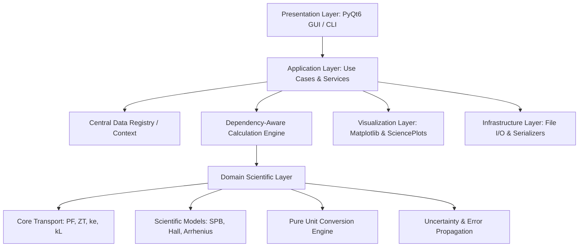

# Seebeck Prime — System Architecture

**Document Version:** 1.0.0  
**Status:** Authoritative Architecture Reference  
**Last Updated:** October 2026  

---

## 1. Project Purpose & Scientific Scope

### 1.1 Purpose
**Seebeck Prime** is a specialized desktop application for experimental thermoelectric materials research and transport analysis. It processes raw experimental data collected from measurement instruments, applies unit conversions, calculates derived thermoelectric properties, performs rigorous uncertainty analysis, and generates publication-grade visualizations.

### 1.2 Boundary & Scope Constraints
- **Scope Focus:** Materials-level experimental analysis, property calculation, and transport modeling.
- **No DFT Calculations:** The application explicitly does **not** perform density functional theory (DFT), electronic band structure simulations, or high-performance ab initio calculations. It is designed to run efficiently and interactively on a standard personal computer without requiring external compute clusters or specialized accelerators.
- **External Data Import:** The application supports importing external simulation outputs or literature data (e.g., CSV/Excel tables) for comparison, but all native compute operations are restricted to analytical and numerical continuum transport equations.
- **Target Audience:** Experimental materials scientists, solid-state physicists, and thermoelectric device researchers.

---

## 2. Current Architecture (As Discovered)

An exhaustive code inspection reveals a transitional codebase with an active legacy UI engine and a partially connected parallel domain package.

### 2.1 Codebase Layout & Entry Points
```text
Seebeck-Prime/
├── main.py                          # Live runtime entry point
├── requirements.txt                 # Dependencies (PyQt6, pandas, numpy, scipy, matplotlib, etc.)
├── pyproject.toml / setup.py        # Build & packaging configurations
├── docs/                            # Authoritative documentation suite
│   ├── ARCHITECTURE.md              # (This document) System architecture
│   ├── MIGRATION_PLAN.md            # Verified issues & refactoring tasks
│   ├── SCIENTIFIC_MODEL_REGISTER.md # Comprehensive scientific inventory
│   ├── SOFTWAREX_VALIDATION_REPORT.md# SoftwareX readiness & test audit
│   └── archive/                     # Preserved legacy planning documents
└── src/
    ├── core/                        # Legacy scientific & analysis core
    │   ├── calculations.py          # Basic transport formulas (0 bytes; .pyc active)
    │   ├── analyzer.py              # Single/multi-sample processing (0 bytes; .pyc active)
    │   ├── constants.py             # Physical constants (source deleted; .pyc active)
    │   └── error_propagation.py     # Gaussian error propagation (source deleted; .pyc active)
    ├── ui/                          # Active PyQt6 GUI implementation
    │   ├── main_window.py           # Legacy main window (source deleted; .pyc active)
    │   ├── dialogs/                 # Modal tool dialogs (kappa, spb, hall, efficiency, error)
    │   ├── logic/                   # UI business logic (kappa, table, unit converter)
    │   └── widgets/                 # Reusable Qt widgets (plot_window.py; table_widget.pyc)
    └── seebeck_prime/               # Parallel domain architecture (Phase 1-2 extraction)
        ├── domain/                  # GUI-independent domain math, units, and models
        │   ├── constants.py         # Authoritative physical constants (CODATA 2018)
        │   ├── calculations.py      # Core formulas (PF, ke, kL, ZT, Kim Lorenz)
        │   ├── dataset.py           # ThermoelectricDataset container
        │   ├── quantities.py        # ScalarQuantity & provenance tags
        │   ├── units.py             # Pure-function unit conversion system
        │   ├── validation.py        # Numerical and physical range validation
        │   ├── analysis.py          # Regression, interpolation, MAD filtering
        │   └── uncertainty.py       # Analytical Gaussian error propagation
        ├── plugins/                 # Modular transport models
        │   ├── electronic.py        # Single Parabolic Band (SPB) & Pisarenko engine
        │   ├── hall.py              # Hall coefficient, carrier concentration, mobility
        │   ├── arrhenius.py         # Arrhenius thermal activation analysis
        │   ├── thermal.py           # Wiedemann-Franz thermal decomposition (duplicate)
        │   └── phonon.py            # Dulong-Petit heat capacity & laser flash kappa
        ├── application/             # Application services & use cases
        │   ├── services.py          # ThermoelectricAnalyzer orchestration service
        │   └── use_cases.py         # High-level transport calculation pipeline
        ├── gui/                     # Proposed modern UI refactor
        │   ├── main_window.py       # Refactored main window (boundary violations present)
        │   ├── dialogs.py           # Consolidated dialog interface
        │   ├── plugin_panels.py     # Modular tool docking panels
        │   └── table.py             # Domain-bound table view
        ├── plot/                    # Matplotlib plotting adapters
        │   ├── plotter.py           # Automated plotting engine
        │   └── plot_config.py       # Theme & scienceplots configuration
        └── infrastructure/          # File I/O and data persistence
            └── io.py                # File reading/writing utilities
```

### 2.2 Runtime Decoupling Status
1. **Application Execution Path:**  
   The primary entry point `main.py` explicitly executes:
   ```python
   from src.ui.main_window import ThermoelectricApp
   ```
   However, `src/ui/main_window.py`, `src/ui/widgets/table_widget.py`, `src/core/constants.py`, and `src/core/error_propagation.py` were removed from source tracking and exist only as compiled CPython bytecode (`__pycache__/*.pyc`).
2. **Parallel Domain Layer (`src/seebeck_prime/`):**  
   A clean, headless domain package was established under `src/seebeck_prime/domain/`. Its modules (`constants.py`, `calculations.py`, `units.py`, `uncertainty.py`, `plugins/electronic.py`, `plugins/hall.py`) operate without any GUI dependencies.
3. **Architectural Gap:**  
   The active application UI has not yet been fully rewired to consume `src/seebeck_prime/domain/`. Instead, `src/seebeck_prime/gui/` contains reverse imports pointing back into legacy `src/ui/*` modules, creating cyclic boundaries.
4. **Test Infrastructure:**  
   No unit test suite currently exists in the workspace. While `.pytest_cache/` is present, all actual test files (`tests/`) are missing from disk.

---

## 3. Target Architecture

The target architecture establishes a clean, maintainable separation of concerns that reuses existing working code without requiring a total rewrite.



### 3.1 Target Components & Responsibilities

1. **Domain Scientific Layer (`seebeck_prime.domain`):**
   - Pure Python / NumPy / SciPy scientific functions.
   - Zero GUI dependencies (no PyQt6, no Qt event loops).
   - Authoritative CODATA 2018 constants.
   - Explicit inputs, outputs, and scientific pre/post-conditions.
2. **Unit Conversion & Validation (`seebeck_prime.domain.units`, `validation`):**
   - Independent pure-function conversion engine.
   - Temperature offset-aware ($^\circ\text{C} \leftrightarrow \text{K}$).
   - Strict dimensionality validation before calculation execution.
3. **Central Data Registry (`seebeck_prime.domain.dataset` / `context`):**
   - Single source of truth for experimental data tables and sample metadata.
   - Decoupled from Qt table widgets (Qt views observe or bind to the registry).
   - Tracks data origins (measured, calculated, interpolated, manual entry).
4. **Dependency-Aware Calculation Engine:**
   - Evaluates calculation prerequisites dynamically.
   - Triggers re-computation of dependent properties only when prerequisite columns change.
5. **Application Layer (`seebeck_prime.application`):**
   - Orchestrates multi-step workflows (e.g., sample file loading $\rightarrow$ unit normalization $\rightarrow$ transport calculation $\rightarrow$ uncertainty propagation).
   - Coordinates single-sample and multi-sample comparisons.
6. **Visualization Layer (`seebeck_prime.visualization` / `plot`):**
   - Generates publication-ready figures via Matplotlib and `scienceplots`.
   - Independent of Qt window widgets; outputs either to Qt canvas widgets or standalone vector files (PDF, SVG, PNG).
7. **User Interface (`seebeck_prime.ui`):**
   - PyQt6 views, docks, and dialogs.
   - Dispatches user events to application services; displays registry data.

---

## 4. Data Registry & Calculation Dependencies

### 4.1 "Enter Once, Reuse Everywhere" Principle
In experimental thermoelectric analysis, multiple transport properties depend on shared raw measurements. The Central Data Registry manages data columns and their dependencies:

| Target Property | Required Registry Inputs | Valid Pre-requisites | Behavior if Incomplete |
|---|---|---|---|
| **Power Factor ($PF$)** | $S$ (Seebeck), $\sigma$ (Conductivity) | Compatible temperature axis | Calculation skipped or flagged |
| **Electronic Thermal Cond. ($\kappa_e$)** | $\sigma$ (Conductivity), $T$ (Temperature), $L$ (Lorenz) | Valid Lorenz choice (Constant or $L(S)$) | Defaults to Sommerfeld limit ($2.44 \times 10^{-8}$) with warning |
| **Lattice Thermal Cond. ($\kappa_L$)** | $\kappa_{\text{total}}$ (Total thermal cond.), $\kappa_e$ | Computed $\kappa_e$ and measured $\kappa$ | Flagged; warning if $\kappa_L < 0$ |
| **Figure of Merit ($ZT$)** | $PF$, $T$, $\kappa_{\text{total}}$ | Valid $PF$, $T > 0$, $\kappa > 0$ | $ZT$ calculated automatically |
| **Weighted Mobility ($\mu_W$)** | $|S|$, $\sigma$, $T$ | Valid transport data; $T > 0$ | Computed using Snyder (2016/2022) relation |
| **Hall Mobility ($\mu_H$)** | $R_H$ (Hall coeff) or $n_H$ (Carrier conc), $\sigma$ | Hall measurement data imported | Requires explicit Hall dataset |
| **SPB Model Inversion** | $S$, $T$, assumed scattering mechanism $r$ | Valid Seebeck data | Numerical Fermi-Dirac inversion for $\eta$ |
| **Device Efficiency / $ZT_{\text{eng}}$** | $T_c$ (Cold side), $T_h$ (Hot side), $S(T), \sigma(T), \kappa(T)$ | Continuous or interpolated curves over $[T_c, T_h]$ | Integration requires temperature range coverage |

### 4.2 Implementation Reality vs Target
- **Current Live Reality:**  
  The active application calculates properties sequentially via DataFrame column assignments in `recalculate_all_properties()` or dialog handlers. No dynamic dependency graph exists; missing columns simply raise key errors or produce empty series.
- **Target Architecture:**  
  A light dependency graph (`CalculationNode` / `RegistryContext`) determines topological execution order and invalidates downstream caches when upstream measurements are modified.

---

## 5. Architectural Constraints

To protect maintainability, usability, and scientific rigor, the following hard constraints apply:

1. **No DFT Calculations:** Never implement DFT or plane-wave pseudopotential codes.
2. **No Literature Search Plugins:** Do not build automated web-scraping or literature search engines into the core runtime.
3. **No Independent Provenance Plugin:** Provenance is an intrinsic software quality attribute tracked via data tags (`DataOrigin.MEASURED`, `CALCULATED`, `INTERPOLATED`) within the dataset, not a separate third-party subsystem.
4. **No Heavyweight Infrastructure:** Avoid distributed task queues (Celery), external database servers (PostgreSQL/MongoDB), cloud services, or GPU compute requirements. Keep the application portable, standalone, and lightweight.
5. **Strict UI/Science Separation:** Domain calculations must never import `PyQt6`, `QObject`, or GUI dialogs.
6. **Single Source of Truth for Calculations:** Never maintain two implementations of the same equation (e.g., eliminate duplicate inline calculations in `error_propagation.py` and `plugins/thermal.py`).
7. **Preserve User Workflows:** The spreadsheet data-entry workflow, clipboard pasting from Origin/Excel, and instant multi-plot generation must remain fully operational throughout migration.

---

## 6. Design Decision Classification

Every architectural pattern and component is classified into one of three distinct categories:

### 6.1 CURRENT (Verified Live Components)
- **PyQt6 GUI Foundation:** Live desktop UI utilizing `QMainWindow`, `QTableWidget`, and modal dialogs.
- **Pandas DataFrame Core State:** Tabular data stored in DataFrames with columns for $T$, $S$, $\sigma$, $\kappa$, $PF$, $\kappa_e$, $\kappa_L$, $ZT$.
- **Analytical Gaussian Error Propagation:** Taylor-series based error propagation for standard transport formulas.
- **Matplotlib Multi-Window Plotting:** Dynamic generation of property plots with error bars and customizable styling.
- **Domain Layer Extraction:** Decoupled modules in `src/seebeck_prime/domain/` for calculations, units, and constants.

### 6.2 TARGET (Agreed Incremental Improvements)
- **Unified Application Entry Point:** Wiring `main.py` directly into `seebeck_prime.application` and the cleaned `seebeck_prime.gui`.
- **Restoration of Missing Source Files:** Re-integrating or cleanly replacing deleted modules (`table_widget.py`, `main_window.py`) from verified domain equivalents.
- **Unified Unit Engine:** Replacing UI-level unit conversions in `unit_converter.py` with pure domain conversions from `domain.units`.
- **Deduplication of Scientific Formulas:** Ensuring `error_propagation.py` and `plugins/thermal.py` call `domain.calculations` exclusively.
- **Automated Test Harness:** Rebuilding a comprehensive unit, regression, and reference-value test suite (`tests/`).

### 6.3 DEFERRED (Out-of-Scope or Future Milestones)
- **Complex Multi-Band / Non-Parabolic Kane Models:** Deferred to post-v1.0 after single-band models are rigorously tested.
- **Full Monte Carlo Uncertainty Propagation:** Deferred until Gaussian analytical propagation is thoroughly validated.
- **HDF5 / Complex Hierarchical Project Serialization:** Tabular CSV/Excel export satisfies current experimental needs; hierarchical container deferred.
- **Command-Line Interface (CLI) Pipeline:** Headless scripting is supported via direct Python import; dedicated CLI argument parser is deferred.
- **Device-Level Engineering Optimization (TEG Leg Geometry):** Materials analysis is the primary mission; complex module simulation is deferred to external tools.
