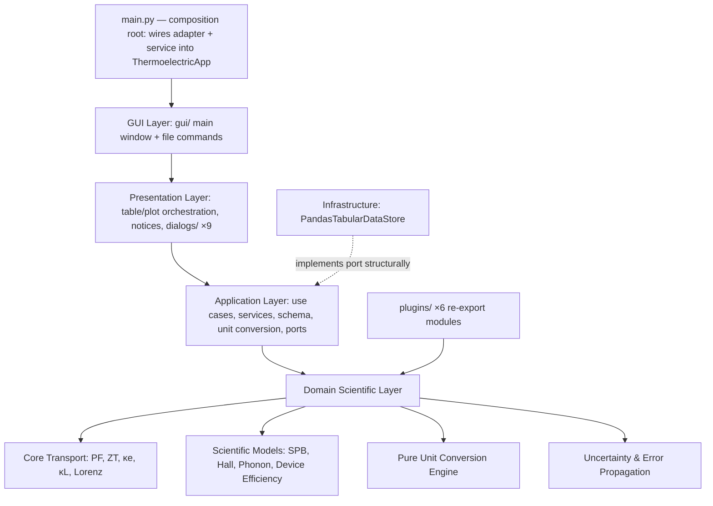

# Seebeck Prime — System Architecture

**Document Version:** 1.1.0  
**Status:** Architecture reference — **as-built** (migration complete 2026-11-13; remaining target components listed in §3.2)  
**Last Updated:** 2026-11-13

---

## 1. Project Purpose & Scientific Scope

### 1.1 Purpose
**Seebeck Prime** is a specialized desktop application for experimental thermoelectric materials research and transport analysis. It processes raw experimental data collected from measurement instruments, applies unit conversions, calculates derived thermoelectric properties, performs rigorous uncertainty analysis, and generates publication-grade visualizations.

### 1.2 Boundary & Scope Constraints
- **Scope Focus:** Materials-level experimental analysis, property calculation, and transport modeling.
- **No DFT Calculations:** The application explicitly does **not** perform density functional theory (DFT), electronic band structure simulations, or high-performance ab initio calculations. It is designed to run efficiently and interactively on a standard personal computer without requiring external compute clusters or specialized accelerators.
- **External Data Import:** The application supports importing external simulation outputs or literature data (e.g., CSV/Excel tables) for comparison, but all native compute operations are restricted to analytical and numerical continuum transport equations.
- **Target Audience:** Experimental materials scientists, solid-state physicists, and thermoelectric device researchers.

---

## 2. Current Architecture (As Built)

The Layered Modular Monolith migration is **complete** (Phases 3–5 finished
2026-11-13; see `docs/ARCHITECTURE_PHASE*_REPORT.md`). `main.py` is the
composition root; `seebeck_prime` contains exactly Domain, Application,
Infrastructure, Presentation, and GUI packages plus the plugins re-export
package. The retired `src/legacy/` tree (and the earlier `src/core` / `src/ui`
/ `src/plot` shadow layouts) no longer exist.

### 2.1 Codebase Layout & Entry Points

```text
Seebeck-Prime/
├── main.py                         # Runtime entry point and composition root
├── pyproject.toml / setup.py       # Build and packaging configuration
├── docs/                           # Audit, architecture, scientific, and maintenance records
├── validation/                     # Scientific equation registry, remediation records
├── tests/                          # Unit, workflow, scientific, and architecture tests
└── src/                            # 60 modules / 8,359 non-blank LOC (measured 2026-11-13)
    ├── seebeck_prime/__init__.py   # Import-root shim (extends __path__ to src/)
    ├── domain/          (13 modules, 2,012 LOC)   # Pure science: calculations, uncertainty,
    │                                              #  units, SPB, Hall, phonon, transport,
    │                                              #  device efficiency, analysis, validation, constants
    ├── application/     (11 modules, 1,262 LOC)   # Use cases, ports, services, table_schema,
    │                                              #  mapping, batch/file workflows, unit_conversion
    ├── infrastructure/  ( 2 modules,    84 LOC)   # Pandas-backed TabularDataStore adapter
    ├── presentation/    (23 modules, 4,192 LOC)   # Table/plot orchestration, UI helpers,
    │   └── dialogs/  ( 9 dialogs + __init__)      #  KappaTool, MultiSample, WeightedMobility,
    │                                              #  HallMobility, SPBModeling, DeviceEfficiency,
    │                                              #  ErrorBar, PlotSettings, ProcessedData
    ├── gui/             ( 4 modules,   652 LOC)   # Main window (28 methods), file commands,
    │                                              #  back-compat table re-export shim
    └── plugins/         ( 6 modules,   136 LOC)   # Domain re-exports only
```

The active window is `src/gui/main_window.py`. It imports its dialogs from
`seebeck_prime.presentation.dialogs.*` — no legacy namespace imports remain
anywhere in `src/`.

### 2.2 Runtime Decoupling Status

1. **Application Entry Point:** `main.py` imports `seebeck_prime.gui.main_window.ThermoelectricApp` and wires the tabular-data service and storage adapter. It is the only place a concrete persistence adapter is instantiated.
2. **Layer Boundaries:** **25 tests** in `tests/test_architecture_dependencies.py` enforce the full inward rule (domain → application → presentation → gui), ban the retired legacy tree across the whole `src/` tree, forbid infrastructure GUI/file-dialog dependencies, and require dialogs to delegate science to application use cases. **7 tests** in `tests/test_import_root.py` enforce the single canonical import root. No sanctioned exceptions remain; the measured import graph is acyclic (`test_internal_package_import_graph_has_no_cycles`).
3. **Presentation Consolidation:** **Complete.** Main-table interaction, plotting, unit display conversion, menu/toolbar construction, Kappa orchestration, and all 9 live dialogs now live in canonical Presentation modules (`presentation/dialogs/`). `gui/table.py` remains as a deliberate back-compat re-export shim whose single-implementation rule is enforced by test.
4. **Scientific Ownership:** Every calculation entry point delegates through Application to Domain; no duplicated science exists in Presentation or GUI (enforced by test). The Lorenz number is **unified**: `DEFAULT_LORENZ = LEGACY_DEFAULT_LORENZ = 2.44e-8 W·Ω·K⁻²` in `domain/physical_constants.py` (the full-precision Sommerfeld value is retained as `SOMMERFELD_LORENZ_EXACT`); the CR-01/CR-02 `calculate_zt` fixes are in place.
5. **Verification:** Phase 5 full suites (2026-11-13, all exit 0): conda environment **738 passed / 10 skipped**, Qt environment **745 passed / 6 skipped**, benchmark suite **119 passed / 7 skipped**. Architecture + import-root + canonical-surface tests: **35 passed**. Static checks: `compileall` clean; mypy 9 errors / 3 files (exact CR-14 baseline); ruff security rules 2 findings (baseline). Qt GUI suites run in the dedicated PyQt6 6.9.1 venv.

---

## 3. As-Built Architecture (final diagram)

The as-built diagram shows the actual dependency structure, measured and
enforced by `tests/test_architecture_dependencies.py`. Composition flows
downward; every arrow points inward.



`main.py` also wires `TableFileService(store)` — the only instantiation of a
concrete persistence adapter in the codebase.

### 3.1 As-Built Components & Responsibilities

1. **Domain Scientific Layer (`seebeck_prime.domain`, 13 modules):** ✅ built
   - Pure Python / NumPy / SciPy scientific functions; zero GUI dependencies; no filesystem access.
   - Authoritative constants (`BOLTZMANN`, `ELECTRON_CHARGE`, …, unified `DEFAULT_LORENZ`).
   - Explicit inputs, outputs, and scientific pre/post-conditions.
2. **Unit Conversion & Validation (`seebeck_prime.domain.units`, `domain.validation`):** ✅ built
   - Independent pure-function conversion engine — the single unit vocabulary for the whole application.
   - Temperature offset-aware ($^\circ\text{C} \leftrightarrow \text{K}$).
   - Strict dimensionality validation before calculation execution.
3. **Application Layer (`seebeck_prime.application`, 11 modules):** ✅ built
   - Orchestrates multi-step workflows (sample file loading → unit normalization → transport calculation → uncertainty propagation).
   - Coordinates single-sample and multi-sample comparisons; defines the `TabularDataStore` port.
4. **User Interface (`seebeck_prime.presentation` + `seebeck_prime.gui`):** ✅ built
   - PyQt6 views, tables, plot windows, and the 9 dialogs in `presentation/dialogs/`.
   - Dispatches user events to application services; owns no science (enforced by test).
5. **Infrastructure (`seebeck_prime.infrastructure`, 2 modules):** ✅ built
   - `PandasTabularDataStore` implements the port structurally (0 internal imports).

### 3.2 Remaining Target Components (not yet implemented)

1. **Central Data Registry (`seebeck_prime.domain.dataset` / `context`):** ⬜ target
   - Single source of truth for experimental data tables and sample metadata.
   - Decoupled from Qt table widgets (Qt views observe or bind to the registry).
   - Tracks data origins (measured, calculated, interpolated, manual entry) — `DataOrigin` tags are not yet enforced at runtime.
2. **Dependency-Aware Calculation Engine:** ⬜ target
   - Evaluates calculation prerequisites dynamically.
   - Triggers re-computation of dependent properties only when prerequisite columns change.
   - Today, table properties are calculated sequentially through DataFrame assignments and dialog handlers (see §4.2).
3. **Standalone Visualization Package (`seebeck_prime.visualization`):** ⬜ target
   - Publication-ready figures via Matplotlib / `scienceplots`, independent of Qt window widgets; outputs to Qt canvas widgets or standalone vector files (PDF, SVG, PNG).
   - Today, plotting lives in `presentation/plot_window.py` and `main_table_plots.py` (Qt-coupled, which is acceptable for the desktop application).

---

## 4. Data Registry & Calculation Dependencies

### 4.1 "Enter Once, Reuse Everywhere" Principle
In experimental thermoelectric analysis, multiple transport properties depend on shared raw measurements. The Central Data Registry manages data columns and their dependencies:

| Target Property | Required Registry Inputs | Valid Pre-requisites | Behavior if Incomplete |
|---|---|---|---|
| **Power Factor ($PF$)** | $S$ (Seebeck), $\sigma$ (Conductivity) | Compatible temperature axis | Calculation skipped or flagged |
| **Electronic Thermal Cond. ($\kappa_e$)** | $\sigma$ (Conductivity), $T$ (Temperature), $L$ (Lorenz) | Valid Lorenz choice (Constant or $L(S)$) | Defaults to Sommerfeld limit ($2.44 \times 10^{-8}$) with warning |
| **Lattice Thermal Cond. ($\kappa_L$)** | $\kappa_{\text{total}}$ (Total thermal cond.), $\kappa_e$ | Computed $\kappa_e$ and measured $\kappa$ | Flagged; warning if $\kappa_L < 0$ |
| **Figure of Merit ($ZT$)** | $PF$, $T$, $\kappa_{\text{total}}$ | Valid $PF$, $T > 0$, $\kappa > 0$ | $ZT$ calculated automatically |
| **Weighted Mobility ($\mu_W$)** | $|S|$, $\sigma$, $T$ | Valid transport data; $T > 0$ | Computed using Snyder (2016/2022) relation |
| **Hall Mobility ($\mu_H$)** | $R_H$ (Hall coeff) or $n_H$ (Carrier conc), $\sigma$ | Hall measurement data imported | Requires explicit Hall dataset |
| **SPB Model Inversion** | $S$, $T$, assumed scattering mechanism $r$ | Valid Seebeck data | Numerical Fermi-Dirac inversion for $\eta$ |
| **Device Efficiency / $ZT_{\text{eng}}$** | $T_c$ (Cold side), $T_h$ (Hot side), $S(T), \sigma(T), \kappa(T)$ | Continuous or interpolated curves over $[T_c, T_h]$ | Integration requires temperature range coverage |

### 4.2 Implementation Reality vs Target
- **Current Live Reality:**  
  The active application still calculates table properties sequentially through DataFrame assignments and dialog handlers. No dynamic calculation registry or dependency graph exists yet; adding either is a later phase requirement.
- **Target Architecture:**  
  A light dependency graph (`CalculationNode` / `RegistryContext`) determines topological execution order and invalidates downstream caches when upstream measurements are modified.

---

## 5. Architectural Constraints

To protect maintainability, usability, and scientific rigor, the following hard constraints apply:

1. **No DFT Calculations:** Never implement DFT or plane-wave pseudopotential codes.
2. **No Literature Search Plugins:** Do not build automated web-scraping or literature search engines into the core runtime.
3. **No Independent Provenance Plugin:** Provenance is an intrinsic software quality attribute tracked via data tags (`DataOrigin.MEASURED`, `CALCULATED`, `INTERPOLATED`) within the dataset, not a separate third-party subsystem.
4. **No Heavyweight Infrastructure:** Avoid distributed task queues (Celery), external database servers (PostgreSQL/MongoDB), cloud services, or GPU compute requirements. Keep the application portable, standalone, and lightweight.
5. **Strict UI/Science Separation:** Domain calculations must never import `PyQt6`, `QObject`, or GUI dialogs.
6. **Single Source of Truth for Calculations:** Never maintain two implementations of the same equation (e.g., eliminate duplicate inline calculations in `error_propagation.py` and `plugins/thermal.py`).
7. **Preserve User Workflows:** The spreadsheet data-entry workflow, clipboard pasting from Origin/Excel, and instant multi-plot generation must remain fully operational throughout migration.

---

## 6. Design Decision Classification

Every architectural pattern and component is classified into one of three distinct categories:

### 6.1 CURRENT (Verified Live Components)
- **Layered Modular Monolith (as built):** gui → presentation → application → domain, enforced by 32 architecture/import-root tests; legacy tree deleted and guarded against return.
- **PyQt6 GUI Foundation:** Live desktop UI utilizing `QMainWindow`, `QTableWidget`, and modal dialogs.
- **Pandas DataFrame Core State:** Tabular data stored in DataFrames with columns for $T$, $S$, $\sigma$, $\kappa$, $PF$, $\kappa_e$, $\kappa_L$, $ZT$.
- **Analytical Gaussian Error Propagation:** Taylor-series based error propagation for standard transport formulas.
- **Matplotlib Multi-Window Plotting:** Dynamic generation of property plots with error bars and customizable styling.
- **Domain Layer Extraction (complete):** All science in `src/domain/` — calculations, uncertainty, units, SPB, Hall, phonon, transport, device efficiency, analysis, validation, constants.
- **Unit-Conversion Consolidation (complete):** One vocabulary in `domain/units.py`; table-facing front end `application/unit_conversion.py` with `QuantityKind` (13 kinds), vectorised batch converters, and linear uncertainty scaling.
- **Presentation Consolidation (complete):** All 9 live dialogs in `presentation/dialogs/`; no legacy namespace imports anywhere in `src/`.
- **Composition Root Discipline:** `main.py` is the only place a concrete persistence adapter is instantiated; dialogs delegate science to application use cases (enforced by test).

### 6.2 TARGET (Agreed Incremental Improvements)
- **Central Data Registry & Calculation Registration:** Add an independent calculation registry and modular input/output contracts after scientific baselines are established (see §3.2 items 1–2).
- **Verification Coverage:** Expand independent reference datasets, end-to-end Qt workflow checks, and migration/compatibility tests.

### 6.3 DEFERRED (Out-of-Scope or Future Milestones)
- **Complex Multi-Band / Non-Parabolic Kane Models:** Deferred to post-v1.0 after single-band models are rigorously tested.
- **Full Monte Carlo Uncertainty Propagation:** Deferred until Gaussian analytical propagation is thoroughly validated.
- **HDF5 / Complex Hierarchical Project Serialization:** Tabular CSV/Excel export satisfies current experimental needs; hierarchical container deferred.
- **Command-Line Interface (CLI) Pipeline:** Headless scripting is supported via direct Python import; dedicated CLI argument parser is deferred.
- **Device-Level Engineering Optimization (TEG Leg Geometry):** Materials analysis is the primary mission; complex module simulation is deferred to external tools.
